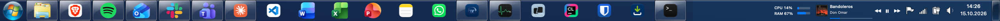
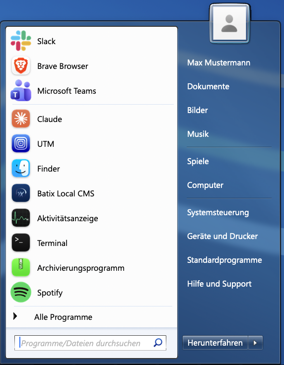
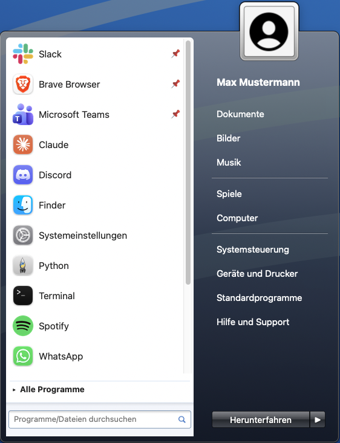
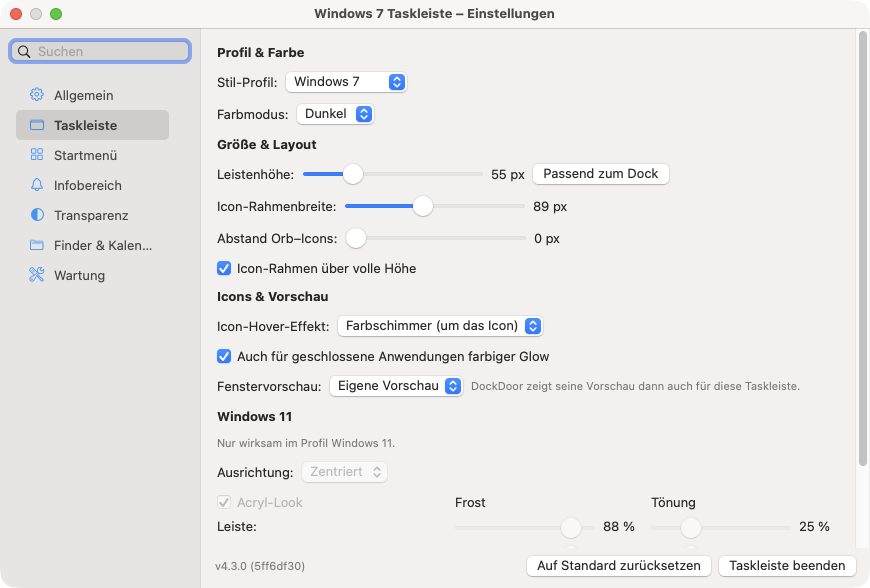

# Windows 7 Taskbar für macOS

Ein nativer **Dock-Ersatz für macOS** im Stil der Windows-7-Taskleiste — geschrieben in
Swift/AppKit, ohne externe Abhängigkeiten. Aero-Glas-Optik, animierter Start-Orb, ein
originalgetreues Windows-7-Startmenü, Fenstervorschau (Aero Peek), Fenstergruppierung,
System-Tray mit den Original-Symbolen und vieles mehr.



<p align="center">
  
  &nbsp;&nbsp;
  
</p>

> Alle Screenshots sind anonymisiert (Platzhalter-Benutzer „Max Mustermann“).
> Links das Startmenü-Design **Original (Windows 7)**, rechts die **bisherige Variante** im Aero-Stil.

---

## Funktionen

### Taskleiste
- Durchgehende **Aero-Glas-Leiste** am unteren Rand; Höhe frei einstellbar
  (oder „Passend zum Dock“), Icon-Rahmenbreite und Abstand zum Orb ebenfalls.
- **Stil-Profile**: Vista, Windows 7 und Windows 11 (siehe unten), jeweils mit
  **Farbmodus** System / Hell / Dunkel.
- **Start-Orb** mit drei animiert übergeblendeten Zuständen (Standard → Hover → *Startmenü
  geöffnet*), auswählbar und um eigene Orbs erweiterbar.
- **Taskbar-Buttons** für laufende & angepinnte Apps. Klickverhalten wie beim Dock:
  - offene Fenster → in den Vordergrund / ausblenden
  - nur minimierte Fenster → wiederherstellen
  - läuft ohne Fenster → neues Fenster öffnen
  - nicht gestartet → Programm starten
  - **Mittelklick** → neues Fenster
- **Win7-Hover-Effekt**: Icons leuchten beim Überfahren in ihrer eigenen Farbe auf —
  wahlweise *folgt der Maus* oder *radial um das Icon*; für geschlossene Apps optional ohne Farbe.
- **Einzelklick** funktioniert sofort, auch wenn eine andere App im Vordergrund ist.
- **Fenstergruppierung**: Apps mit mehreren Fenstern zeigen gestaffelte Rahmenkanten.
- **Badges** (z. B. ungelesene Nachrichten in Slack/Teams) werden vom Dock übernommen.
- **Drag & Drop**: Apps auf die Leiste ziehen → angepinnt; Icons frei umsortieren.
- **Automatisch ausblenden** (am unteren Rand wieder einblenden), Ausblenden im **Vollbild**,
  optional auf **allen Bildschirmen**; robust beim An- und Abstecken von Monitoren.

### Startmenü
Zwei Designs, umschaltbar unter *Einstellungen → Startmenü → Darstellung*:

**Original (Windows 7)** — ein 1:1-Nachbau des *SevenStart*-Menüs aus
[AeroThemePlasma](https://github.com/aeroshell-desktop/aerothemeplasma):
- Maße aus der Original-QML, Rahmen pixelgenau aus den Original-SVGs gerastert (gestochen scharf
  auf 1×- und Retina-Bildschirmen), skaliert mit der Taskleistenhöhe.
- **Aero-Glas wie unter Windows 7**: leichter Blur und die DWM-Einfärbung „Sky“ wie im
  AeroGlassBlur-Effekt, dazu die Reflexionsstreifen — gleichmäßig transparent, oben gerundet.
- Schwebendes Profilbild, das beim Überfahren rechts in das Symbol des Eintrags überblendet.
- **Alle Programme** als aufklappbarer Ordnerbaum, **Suche** nach Programmen und Dateien,
  Herunterfahren-Splitbutton mit Sperren / Abmelden / Energie sparen / Neu starten.
- **Größe per Ziehen** an der oberen rechten Ecke anpassbar.
- Nutzt **Segoe UI**, sofern vorhanden (siehe [Schrift](#schrift-segoe-ui)).

**Bisherige Variante** — das frühere Zweispalten-Menü mit den Stilen *Akzentfarbe* oder
*Taskbar-Aero*, Deckkraft und Unschärfe einstellbar.

Für beide:
- **Zuletzt geöffnete** Programme (selbst getrackt), angepinnte zuoberst.
- **Rechtsklick** auf einen Eintrag: anheften, im Finder zeigen, Desktopverknüpfung,
  **deinstallieren** (App samt Daten in den Papierkorb).
- Rechte Spalte frei bearbeitbar (Orte, Trenner, eigene Einträge).
- Tastenkürzel frei belegbar (Standard: **fn (Globe) + Control**); **Ctrl + 1…9** startet/aktiviert
  die n-te angepinnte App.

### Infobereich (System-Tray)
- **Original-Windows-7-Symbole** (aus AeroThemePlasma) für Netzwerk mit Signalstärke,
  Lautstärke und Akku.
- **Benachrichtigungs-Flagge** — öffnet die macOS-Mitteilungszentrale.
- **Now-Playing** (Spotify/Apple Music mit Fortschritt und Steuerung) und
  **Hardware-Monitor** (CPU/RAM-Balken).
- **Uhr** (optional mit Sekunden) → Kalender mit Terminen aus dem macOS-Kalender.
- Symbolgröße und Abstände global oder **je Symbol** einstellbar, **Reihenfolge** per Liste,
  jedes Element einzeln abschaltbar.

### Windows-11-Profil
- **Flache Leiste** mit Windows-11-Logo in der macOS-Akzentfarbe, Icons **zentriert** oder
  linksbündig, Laufanzeige als Pill; optionaler **Acryl-Look** (Frost/Tönung einstellbar).
- **Startmenü im Stil 24H2/25H2**: Suchfeld, „Angeheftet“-Raster, alle Apps von A bis Z mit
  Buchstaben-Sprungmarken.
- **Tray** mit Medien-Flyout, Leistungsübersicht, WLAN/Lautstärke/Akku und zweizeiliger Uhr.

### Fenstervorschau (Aero Peek)
- Live-Thumbnails beim Hovern (ScreenCaptureKit), inkl. **minimierter** Fenster,
  **×-Knopf** zum Schließen; Klick auf eine Vorschau holt das Fenster nach vorn.
- Alternativ kann die Vorschau von [DockDoor](https://github.com/ejbills/DockDoor) verwendet werden.

### Fensterverwaltung
- **Platz-Reservierung**: hält Fenster über der Leiste (Bedienungshilfen-API).
- **macOS-Dock ausblenden** per Einstellung; angeheftete Dock-Apps lassen sich übernehmen.

### Jump-Lists (Rechtsklick auf ein Taskbar-Icon)
- **Browser** (Brave/Chrome/Edge/Chromium/Vivaldi): Profile auswählen
- **Finder**: persönliche Ordner; **„Alle Fenster schließen“** (Finder wird nie beendet)
- **Terminal**: neues Fenster · **Mail**: neue Nachricht · **Spotify/Music**: Steuerung · **VS Code**: neues Fenster

### Einstellungen

<p align="center"></p>

Rechtsklick auf den Orb → **Einstellungen…** — mit Seitenleiste und **Suche**:
- **Allgemein**: Verhalten, Autostart, Dock ausblenden, Fensterbereich reservieren
- **Taskleiste**: Stil-Profil & Farbmodus, Größe & Layout, Hover-Effekt, Fenstervorschau,
  Windows-11-Optionen
- **Startmenü**: Start-Symbol, Design & Stil, rechte Spalte, Tastenkürzel
- **Infobereich**: Größen, Reihenfolge und Funktionen der Tray-Symbole
- **Transparenz**: Deckkraft/Unschärfe von Leiste und (bisherigem) Startmenü
- **Finder & Kalender**: Finder-Verhalten und -Symbol, Kalendertermine
- **Wartung**: Einstellungen **exportieren/importieren**, Dock-Apps übernehmen,
  **Updates** (aus dem Quellcode bauen, mit Fortschrittsanzeige)

---

## Installation

Voraussetzungen: **macOS 14+**, Xcode-Toolchain (Swift 5.9+).

```bash
# (Einmalig, empfohlen) stabile Signatur → erteilte Berechtigungen überleben Rebuilds:
./setup-signing.sh

./build.sh
open Win7Taskbar.app
```

Ohne `setup-signing.sh` wird ad-hoc signiert (funktioniert ebenfalls, Berechtigungen müssen
dann nach jedem Rebuild neu erteilt werden). Alternativ liegt jedem
[Release](https://github.com/niklas-urbantke/MacOS-Windows-7-like-Taskbar/releases) eine
`Win7Taskbar.dmg` bei. Spätere Updates gehen direkt aus der App (*Einstellungen → Wartung*).

### Schrift (Segoe UI)
Das Original-Startmenü verwendet — wie Windows 7 und AeroThemePlasma — **Segoe UI** (12 px).
Die Schrift ist von Microsoft lizenziert und wird **nicht mitgeliefert**. Wer eine Windows-7-Lizenz
hat, kopiert `segoeui.ttf` (und optional `segoeuii.ttf` für Kursiv) aus `C:\Windows\Fonts` nach

```
~/Library/Application Support/Win7Taskbar/fonts/
```

Ohne Segoe UI wird die Systemschrift verwendet.

### Eigene Orbs
Orbs liegen in `orbs/` (Windows 7 + Apple) und werden eingebunden. Zur Laufzeit durchsucht die
App zusätzlich `~/Library/Application Support/Win7Taskbar/orbs/` — dort abgelegte PNGs
erscheinen in der Auswahl (oder per „Orb hinzufügen…“ im Einstellfenster). Ein Orb-PNG hält die
drei Zustände vertikal gestapelt (normal / Hover / geöffnet).

---

## Berechtigungen

| Berechtigung | Wofür |
|---|---|
| **Bildschirmaufnahme** | Vorschaubilder der Fenster (Aero Peek) |
| **Bedienungshilfen** | Platz-Reservierung, minimierte Fenster, Fenster schließen/wiederherstellen, Badges, Mitteilungszentrale, Hotkeys |
| **Automatisierung** (Finder/System Events/Spotify/Music) | Energie-Aktionen, Finder-Fenster, Now-Playing |
| **Kalender** (optional) | Termine im Kalender der Uhr |

Alle unter *Systemeinstellungen → Datenschutz & Sicherheit* aktivieren.

---

## Autostart

Im Einstellfenster (*Allgemein → Beim Anmelden automatisch starten*) oder unter
*Systemeinstellungen → Allgemein → Anmeldeobjekte*.

---

## Projektaufbau

```
Sources/Win7Taskbar/
  main.swift / AppDelegate.swift       Einstieg (Agent-App), Erzeugung pro Bildschirm
  TaskbarController.swift              Fenster, Layout, laufende Apps, Tray, Vollbild, Hotkeys, Drag&Drop
  Theme.swift / ThemeAssets.swift      Maße, Farben, Einstellungen + Theme-Grafiken
  GlassBackgroundView.swift            Aero-Glas-Hintergrund + Drop-Ziel
  StartOrbButton.swift / OrbCatalog    Animierter Orb + Orb-Verwaltung
  TaskbarButton.swift / TaskbarItem    Taskbar-Button (Zustände, Gruppierung, Hover-Glow) + Modell
  StartMenu7.swift                     Startmenü „Original (Windows 7)“ (SevenStart-Nachbau)
  StartMenu.swift                      Startmenü „bisherige Variante“
  StartMenu11.swift / StartMenuShared  Windows-11-Startmenü + gemeinsame Menü-Logik
  StartMenuActions.swift               Aktionen der rechten Spalte (gemeinsam für alle Menüs)
  MenuEditorWindow.swift               Editor für die rechte Spalte
  Win11Tray.swift / Win11Flyouts       Windows-11-Tray (Medien, Leistung, Uhr) + Flyouts
  TrayWidgets / TraySizeRow / TrayOrderListView   Tray-Symbole, Größen, Reihenfolge
  SystemInfo / SystemStats             Akku, Lautstärke, WLAN, CPU/RAM
  NowPlaying(.View).swift              Spotify/Music-Abfrage + Widget
  CalendarEvents.swift                 Termine aus dem macOS-Kalender
  AppScanner / RecentsStore / PinStore Programme finden, zuletzt geöffnet, Pins
  AppUninstaller.swift                 Apps samt Daten deinstallieren
  WindowPreview(.Controller).swift     Fensterliste + Thumbnails + Aero-Peek-Panel
  DockDoorBridge.swift / DockBadges    DockDoor-Vorschau, Badges aus dem Dock
  WindowSpaceReserver.swift            Platz-Reservierung (Bedienungshilfen)
  JumpList.swift                       App-spezifische Rechtsklick-Aktionen
  SettingsWindow.swift / SettingsIO    Einstellfenster + Export/Import
  UpdateManager.swift                  Self-Update aus dem Quellcode
  DockHelper.swift                     Dock ausblenden/einblenden
ThemeResources/                        Grafiken (u. a. sm-* = Startmenü-Rahmen aus AeroThemePlasma)
```

---

## Bekannte Grenzen

- Eine Drittanbieter-App kann **keinen** echten OS-Slot wie das Dock reservieren; die
  Reservierung hält Fenster per Bedienungshilfen oberhalb der Leiste.
- Das macOS-Dock lässt sich nicht vollständig beenden — die App versetzt es in den Auto-Hide.
- Fremde Menüleisten-Symbole anderer Apps lassen sich nicht in den Tray holen; systemweite
  Now-Playing-Infos sind für Fremd-Apps gesperrt, daher die direkte Spotify/Music-Abfrage.
- Der Glas-Blur des Original-Startmenüs nutzt eine nicht öffentliche macOS-Schnittstelle; fehlt
  sie, wird automatisch auf das Standard-Material zurückgefallen.
- macOS rendert Schrift ohne Hinting/ClearType — Segoe UI wirkt daher etwas weicher als unter Windows.

---

## Lizenz & Danksagung

Privates Projekt. Windows 7, Segoe UI und das Windows-Logo sind Marken bzw. Eigentum der
Microsoft Corporation — dieses Projekt ist ein nicht-kommerzieller, optischer Nachbau ohne
Verbindung zu Microsoft.

Startmenü-Grafiken, Tray-Symbole und Glas-Parameter stammen aus bzw. orientieren sich an
[AeroThemePlasma](https://github.com/aeroshell-desktop/aerothemeplasma) (wackyideas und Mitwirkende, AGPL-3.0).
